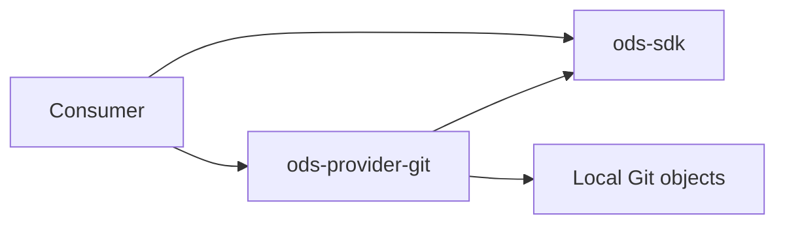

# ADR-0033: Read-only immutable producing-code retrieval

- **Status:** Proposed
- **Date:** 2026-11-03
- **Issues:** #462
- **Deciders:** Maintainers

## Context

ADR-0032 locates producing-code references, but consumers cannot yet inspect source.
A local checkout may have moved or contain uncommitted changes. Retrieval must not
misrepresent those files as historical evidence, execute inspected code, follow an
unapproved repository reference, or place source literals in routine reports.
AGENTS rules 1–4 and 9 require neutral contracts and explicit uncertainty.

## Options considered

### Read working-tree paths

Simple, but a clean status does not pin the file to a producing run; path and symlink
races complicate containment. Filters can alter checkout contents.

### Read immutable Git objects from approved repositories

Selects an exact commit and bypasses dirty files, checkout filters and symbolic-link
resolution. Requires Git and a host-managed local object store; absent objects stay
missing rather than triggering a network fetch.

## Decision

Add a separate async `CodeReader` contract to ods-sdk and an `ods-provider-git`
implementation for approved, host-controlled standard local repositories. The host
maps repository aliases to checkout roots and sets byte/deadline limits. A source
must have an exact commit and a matching producing-run identity before retrieval.
Current and unknown revisions return `RevisionRequired`; no implicit HEAD lookup.

The provider canonicalizes the approved checkout and its Git/object directories,
rejects external Git directories, linked/bare layouts and object alternates, then
reads a literal path from the immutable commit. Only regular blob entries are
accepted; symbolic links, submodules and trees are not source documents. Git runs
with replacement objects and lazy fetching disabled, no inherited GIT environment,
no stdin and discarded stderr. No checkout, diff, hooks, textconv or filters run.
Git 2.48+ must be installed by the host; existing workspace dependencies
process-wrap, tempfile and url are reused.

The remote reader adds a credential-free HTTPS fetch into a fresh temporary Git
object store, then delegates to the local reader. Its host allowlist supplies URLs;
project metadata supplies only aliases. URLs cannot carry user info, query strings
or fragments; redirects are disabled. It fetches one exact commit at depth one,
with no tags/submodules, no checkout and no configured remote. The environment is
cleared, including SSH agents, tokens, askpass and proxy credentials; Git credential
helpers, global/system configuration and templates are disabled. Private access
requires a separately configured provider with server-enforced read-only credentials.
There is deliberately no push API. The shared authorization gate defaults to
unverified and refuses both write-capable and unverifiable credentials. Credentialed
adapters must inspect effective target-repository grants with the remote authority;
a caller-provided read-only flag is not sufficient. Built-in readers accept no auth. Disabling push in a local config is not a sandbox
for arbitrary code holding a write token; native plugins remain trusted.

A total async deadline and bounded stdout reads apply. Timeout/cancellation kills
the Git process group (a job object on Windows), including HTTPS helpers. Repository internals are trusted host-managed storage and must not
be concurrently replaced by an adversary; this is not a sandbox for hostile local
repositories. Concurrent hostile storage requires a different isolation boundary. Remote fetch
pack storage requires host disk quotas; the byte limit governs returned source and
command output, not total transferred pack bytes. Source is UTF-8 text (NUL bytes rejected), at most 8 MiB under host policy.

`CodeDocument` is not serializable; Debug omits the body. Consumers explicitly opt
in to source access and validate plugin location, commit, size and deadline before
accepting it. The document remains code evidence, never proof of a causal diagnosis
or proof that a declared run association is accurate. Routine reports carry only
metadata. The fake provider runs the same SDK conformance checks.

## Consequences

- Positive: dirty working copies cannot silently alter historical code evidence;
  platform-specific retrieval stays outside consumers.
- Trade-offs: local objects, standard checkout layout and a sufficiently recent Git
  are required. Current-only references need another resolution step. Native reader
  plugins remain trusted; host timeouts are cooperative for arbitrary plugins.
- Follow-up: #462 retains authenticated read-only Git providers, current-ref resolution, process
  transport and catalog-derived code references. #170 remains live UC ingestion.

## References

- [ADR-0032](0032-producing-code-references.md)
- [#462](https://github.com/buchochelliq-labs/open-data-suite/issues/462)
