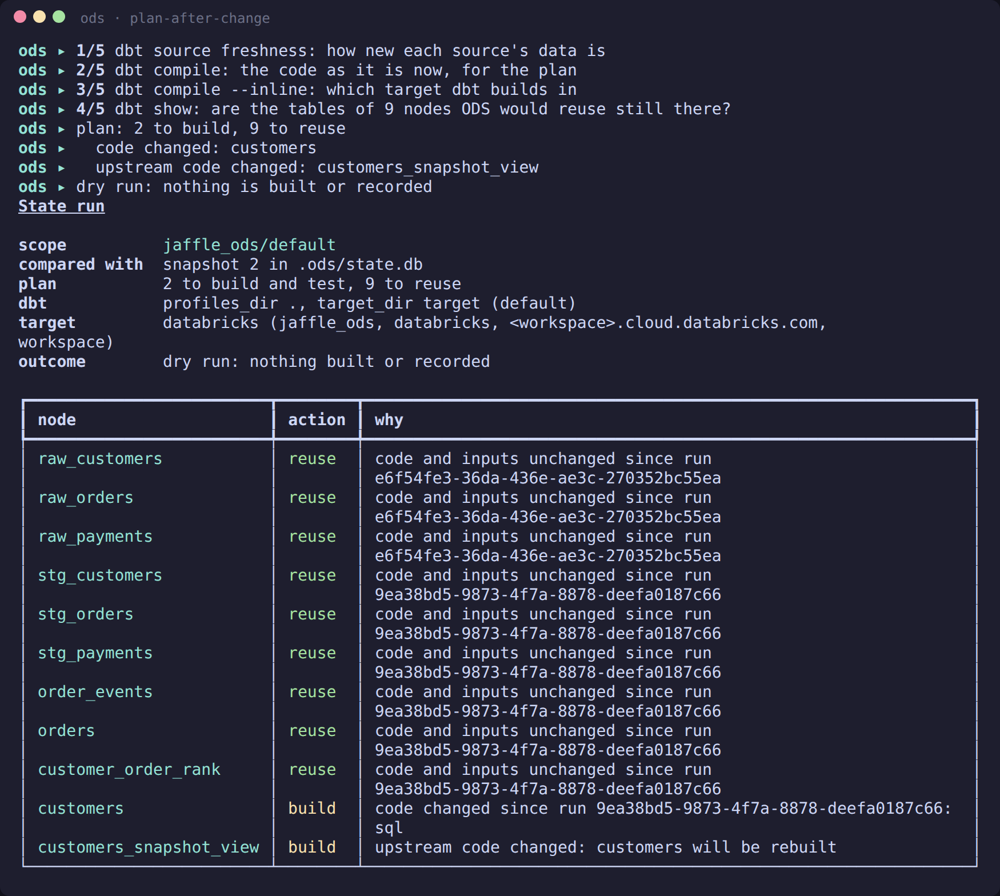
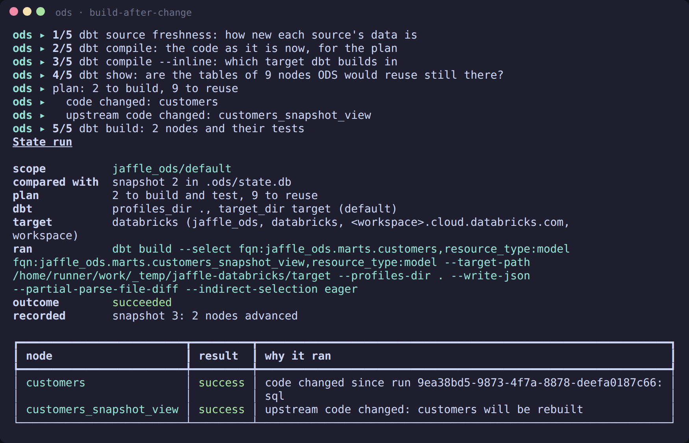
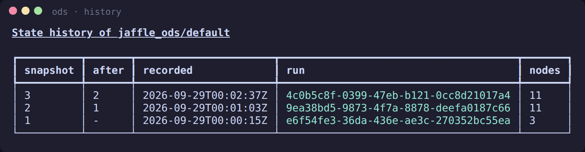

# ODS State on Databricks

`ods state` works with any dbt adapter, because dbt does the building and ODS decides
what needs building. This page shows it on **Databricks**, using the demo project from
the [getting started](getting-started.md) guide. The screenshots come from the nightly
`databricks` CI job, which runs these commands against a real Databricks Free Edition
workspace (#294). The workspace hostname is redacted.

## Setup
Use your usual `profiles.yml` with `type: databricks`. ODS reads nothing from it: it
asks dbt which target it builds in, and keeps state per target
([ADR-0017](adr/0017-state-per-target.md)).

```bash
pip install dbt-databricks        # the dbt adapter; ODS itself needs nothing extra
ods state seed                    # load the seeds
ods state build                   # build everything once, and record it
```

Each run records what it built, from which code and inputs, in `.ods/state.db`.

## A change rebuilds only what it affects
Change one model, `customers`, and ask what a build would do:

```bash
ods state build --dry-run
```



Nine nodes are reused and two are built:
- `customers`, because its code changed;
- `customers_snapshot_view`, because it reads `customers`.

Every decision has a reason. Before reusing anything, ODS checks with `dbt show` that
the tables it would reuse still exist in the workspace (step 4/5).

Then build:

```bash
ods state build
```



ODS ran `dbt build` with exactly those two models selected, then recorded the new
state. Nothing else was touched in the warehouse.

## History
Each run that builds something successfully records a snapshot. A node that fails,
or is skipped, keeps its last successful entry. So after a partial run, the nodes that
succeeded move on, and the rest stay exactly as they were.

```bash
ods state history
```



## Open a model in Catalog Explorer
`ods serve`'s dashboard links each model to its table in Catalog Explorer, the
workspace's UI for Unity Catalog: the model page's header has an **Open in Catalog
Explorer ↗** button, and the lineage explorer's side panel and a run's Nodes table have
the same link (#329). `ods lineage graph --format json` and `ods lineage columns --output
json` carry it as `relation_url`.

The link is built from the workspace URL, which ODS reads from `ods.toml` (or from
`DATABRICKS_HOST`, which is read first, as in
[ADR-0021](adr/0021-databricks-authentication.md)):

```toml
[providers.uc]
kind = "databricks"

[providers.uc.settings]
host = "https://<workspace>.cloud.databricks.com"
```

A model whose relation is `catalog.schema.table` links to
`https://<workspace>/explore/data/catalog/schema/table?o=<workspace id>`, each name
percent-encoded. The host must be `https://` (or a bare host name); a trailing `/` is
dropped, and a path, a query string or a user name is refused.

The workspace id (`?o=`) picks the workspace when one host serves several. It is the
number after `?o=` in your browser's address bar when you are in the workspace. ODS
takes it from `workspace_id`:

```toml
[providers.uc.settings]
host = "https://<workspace>.cloud.databricks.com"
workspace_id = "1234567890123456"
```

Without `workspace_id`, it is read from a host that contains it: Azure's
`adb-<workspace id>.<n>.azuredatabricks.net` and GCP's
`<workspace id>.<n>.gcp.databricks.com`. AWS hosts (`dbc-….cloud.databricks.com`)
don't contain it, so their links have no `?o=` unless you set `workspace_id`. ODS
refuses a `workspace_id` rather than guess, and the page says why, when it:
- isn't a number;
- differs from the id in an Azure or GCP host;
- differs between two Databricks providers that share a host or use `DATABRICKS_HOST`. Neither setting is a
secret, and no token is ever put in a link. Nothing is fetched to build it.

The link is where the manifest says the table is. It isn't proof that the table
exists: it may not have been built yet, or may have been dropped. When there is no link,
the page says why instead of guessing one: no `host` configured, a host or
`workspace_id` that can't be used, a relation named with only two parts (the catalog would be a guess), or a name
that isn't well formed (whitespace inside an unquoted name, text after a closing
backtick, or a name that is `.` or `..`), which is never repaired.

## Sign in to the workspace

ODS can sign in to the workspace itself, for the Databricks features that will call its
APIs ([ADR-0021](adr/0021-databricks-authentication.md)). No command uses it yet: dbt
still connects with its own profile, and `ods doctor` will show the sign-in next.

Two methods so far, each used only when named with `auth`:

```toml
[providers.uc]
kind = "databricks"

[providers.uc.settings]
host = "https://<workspace>.cloud.databricks.com"   # or DATABRICKS_HOST
auth = "m2m"                                          # a service principal's OAuth secret
client_id = "<application id>"                        # not a secret
client_secret = { secret = "env:DATABRICKS_CLIENT_SECRET" }
scopes = ["sql"]                                      # optional: default sql, then all-apis
```

- **`m2m`** exchanges the service principal's secret for a token at
  `<host>/oidc/v1/token`. It asks for each scope in `scopes` in turn while Databricks
  answers that the scope isn't assigned to the principal, and stops at any other
  refusal. The token is reused until a minute before it expires.
- **`pat`**, the last resort, sends a static token as is:
  `auth = "pat"` and `token = { secret = "env:DATABRICKS_TOKEN" }`. Nothing checks it
  until an API is called with it. The short-lived token that `.github/databricks/ci.py`
  exports is an OAuth token, and works here too.

`client_secret` and `token` are secret references, never the values
([secrets](cli.md#configuration)): they are resolved only when a token is needed, and
tokens stay in ODS's memory. They are never written to configuration, state, logs or
output, and an error from the token endpoint has the secret removed before it is shown.
Only `https://` hosts are accepted and redirects are not followed. `auth = "cli"` (your
`databricks auth login`) and federation come later; `profile`, `cli_path` and
`audience` are refused until then.

## Next steps
- **`ods state explain <node>`:** why a node was built or reused. See the [CLI reference](cli.md).
- **`ods state retry --failed`:** after a failure, rebuild only what failed.
- **`ods state history --run <run_id>`:** one run's per-node stats (result, time taken,
  rows, thread, redacted error) from its run journal. The screenshots above predate the
  per-node stats; the [CLI reference](cli.md#run-stats-and-the-run-journal) shows them.
- **`ods state export`:** a dbt state that `dbt retry --defer-state` and
  `--defer --favor-state` can trust
  ([ADR-0020](adr/0020-dbt-state-interop-and-favor-state.md), [more](cli.md#state-export-for-dbt-deferral)).
- **Coming next:** direct Databricks sign-in for Unity Catalog metadata
  ([ADR-0021](adr/0021-databricks-authentication.md)).
- **Contributors:** [Testing against Databricks](contributing-databricks.md) covers how
  the CI job and these screenshots are made.
