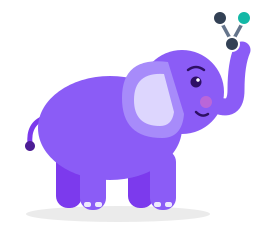
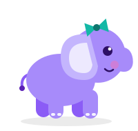
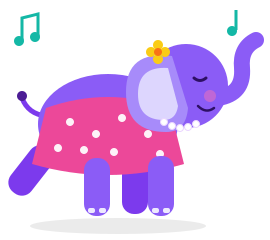
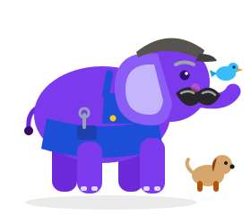

# Meet the herd

ODS is looked after by a family of purple elephants. Elephants never forget, and
neither does ODS: it remembers what every run built, and why.

-   

    **Nemo**

    ---

    The ODS mascot. Nemo keeps track of what depends on what, and holds the graph up
    for everyone to see. When something changes, she knows exactly which models it
    reaches, and which it doesn't.

-   

    **Tui**

    ---

    Nemo's daughter. Tui is small, curious and always asking "but *why*?", which is
    why every decision ODS makes comes with its reasons
    ([`ods state explain`](cli.md)).

-   

    **Nana**

    ---

    Tui's nana, and a jiver. Put on anything with a beat and Nana is on her feet, in
    her polka dots and pearls, with a flower behind her ear. She keeps the herd in
    rhythm.

-   

    **Grandpa**

    ---

    Tui's grandpa. A hard worker: first up, last to stop, a spanner always in his
    pocket. He loves animals, and there's usually a bird on his trunk and a puppy at
    his feet. His big black-and-grey moustache is the pride of the herd.

