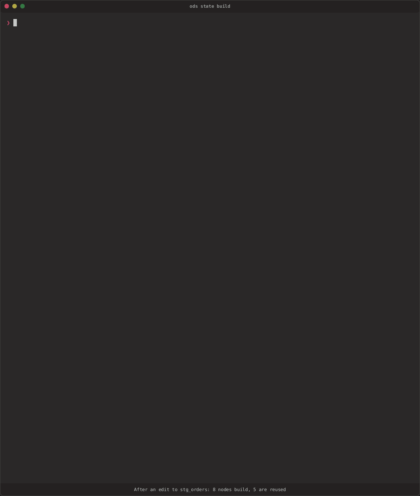
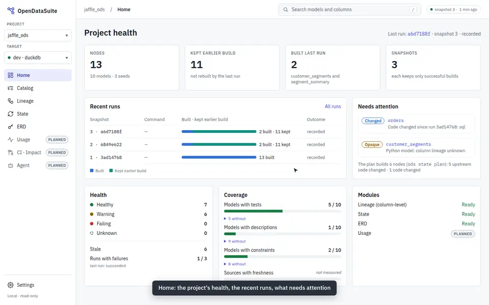

<div class="ods-hero" markdown>

# Analytics engineering that explains itself

<p class="ods-hero__lead">
OpenDataSuite (ODS) reads a dbt project's compiled artifacts, answers questions about
them, and runs dbt on only what needs to run. Every answer comes with the evidence
behind it.
</p>

<div class="ods-hero__actions" markdown>

[Get started](getting-started.md){ .md-button .md-button--primary }
[Install](install.md){ .md-button }
[View on GitHub](https://github.com/buchochelliq-labs/open-data-suite){ .md-button }

</div>

<p class="ods-hero__meta">
Open source (Apache-2.0) · written in Rust · no account, no telemetry · pre-alpha
</p>

</div>

## What it does

<div class="grid cards" markdown>

-   :material-lightning-bolt:{ .lg } **Build only what changed**

    ---

    `ods state build` runs dbt on the models whose code or upstream data changed,
    reports each node's time and rows, and explains every decision.

    [:octicons-arrow-right-24: Getting started](getting-started.md#6-build-only-what-changed)

-   :material-view-dashboard-outline:{ .lg } **A read-only dashboard**

    ---

    `ods serve` shows the plan, the runs with each node's stats, lineage coloured by
    what the next run does, and the catalog.

    [:octicons-arrow-right-24: The dashboard](cli.md#the-dashboard)

-   :material-source-branch:{ .lg } **Column-level lineage**

    ---

    Where every column comes from and what uses it, down to joins, filters and
    aggregations, with an offline explorer.

    [:octicons-arrow-right-24: Column-level lineage](lineage.md)

-   :material-target:{ .lg } **Change impact**

    ---

    Which models must run when a column changes, and which can be skipped because
    they don't read it.

    [:octicons-arrow-right-24: How impact is decided](lineage.md#change-impact)

-   :material-sitemap-outline:{ .lg } **Entity-relationship diagrams**

    ---

    Keys and relationships from your tests, constraints and joins, each labelled
    with how it's known.

    [:octicons-arrow-right-24: ERDs](capabilities.md#entity-relationship-diagrams)

-   :material-robot-outline:{ .lg } **An MCP server for AI agents**

    ---

    The same engines as read-only tools for agents, including help writing SQL for
    people new to a project.

    [:octicons-arrow-right-24: MCP](capabilities.md#mcp-server-for-ai-agents)

</div>

## See it run

After an edit to one staging model, `ods state build` builds the 8 nodes that depend on
it, reuses the other 5, and says why each one ran:



## Try it in five minutes

```sh
pip install opendatasuite      # or: brew install buchochelliq-labs/tap/ods
cd my-dbt-project && dbt compile
ods lineage view --open        # explore the lineage, offline
ods state build                # build what needs it, and record the run
ods serve                      # the dashboard, on http://127.0.0.1:8765/
```

[Getting started](getting-started.md) walks through each step on a demo project, and
[Install](install.md) covers Homebrew, cargo-binstall and direct downloads.



## How it works

<div class="grid cards ods-grid-2" markdown>

-   :material-shield-check-outline:{ .lg } **Conservative**

    ---

    When ODS can't tell, it assumes the safer answer: it marks a model as affected,
    not skipped, and labels a relationship as a guess, not a fact.

-   :material-text-search:{ .lg } **Explainable**

    ---

    Every decision carries a reason chain and evidence, as text and as JSON.

-   :material-puzzle-outline:{ .lg } **Provider-neutral**

    ---

    dbt is the first project format and Databricks the first warehouse. Neither is
    built into the core. [Principles](principles.md)

-   :material-lock-open-outline:{ .lg } **Open**

    ---

    ODS works with dbt through its public artifact formats, and is built on
    open-source libraries. [Legal and trademarks](legal.md)

</div>

!!! info "Status"
    ODS is **pre-alpha**. Commands, flags, output and file formats change without
    notice, and results can be incomplete or wrong. Use it to explore and to give
    feedback, and don't rely on it for production decisions yet. The
    [roadmap](ROADMAP.md) says what comes next.

<small>ODS is an independent open-source project. It is not affiliated with, endorsed
by or sponsored by dbt Labs, Databricks or any other vendor named on this site.</small>
